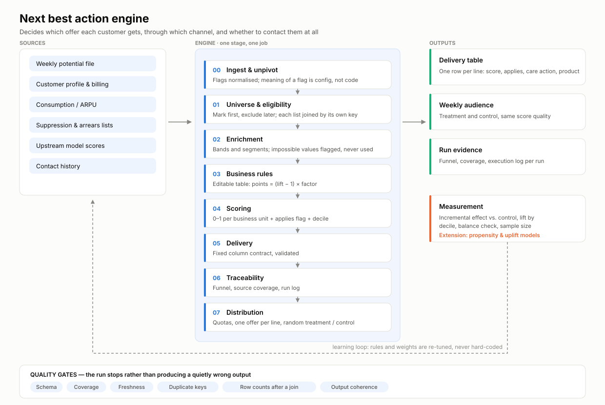
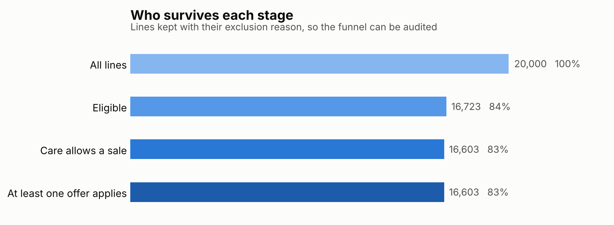
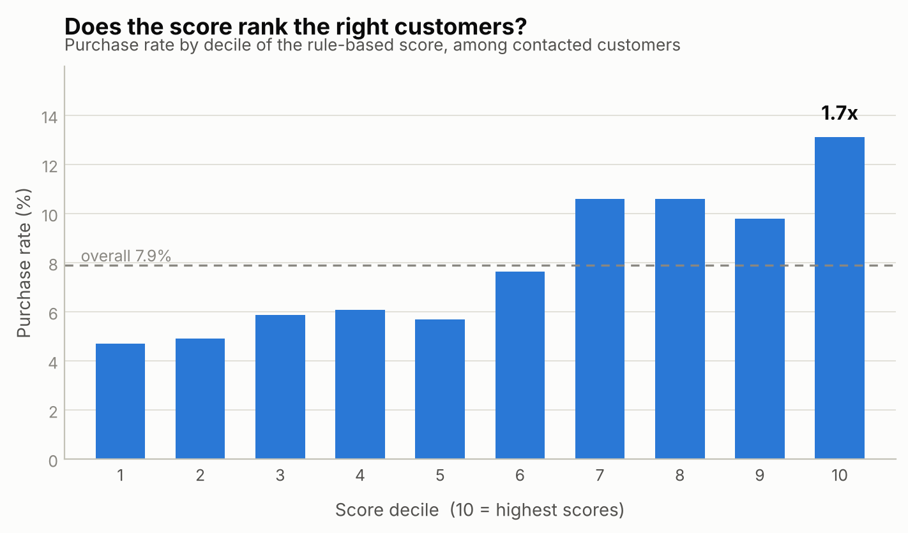
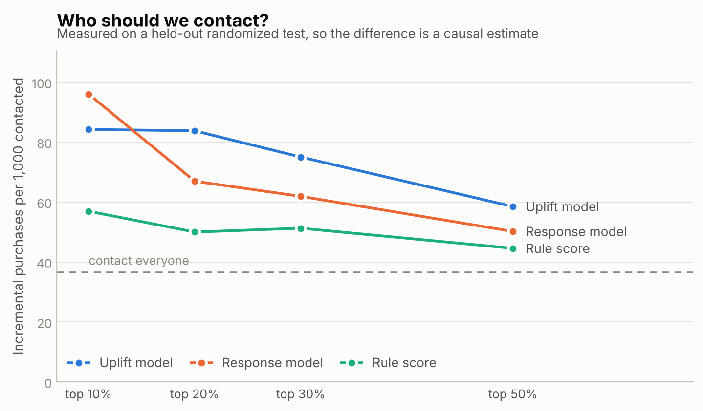
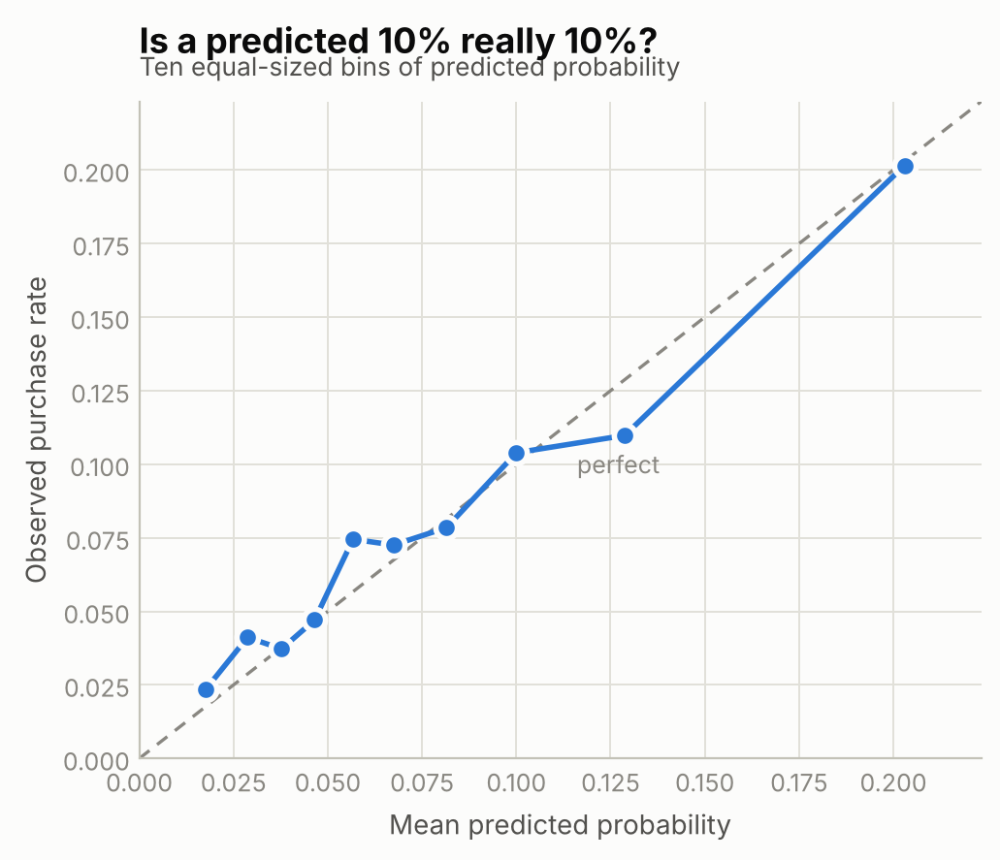

# Next Best Action Engine

[](https://github.com/DKATP/Next-Best-Action_Engine/actions/workflows/tests.yml)
[](pyproject.toml)
[](LICENSE)

A decision engine that answers three questions for every customer of a telecom operator: **which offer, through which channel, and whether it is prudent to contact them at all.** On top of it, a modelling extension that asks the harder question: *who buys **because** we contacted them?*

> **Everything here runs on synthetic data.** No real customer, employer or operator data, code, table names or business parameters are included. Identifiers use a deliberately invalid prefix (`999…`) and every weight, band, lift and quota is invented. This is a clean re-implementation of *design patterns*, not a copy of any production system.

<picture>
  <source media="(prefers-color-scheme: dark)" srcset="docs/img/architecture-dark.svg">
  
</picture>

## The problem

Several business units want to sell to the same customers, each measuring success differently. Without coordination, one customer is contacted by four teams in a week, customers in arrears receive sales offers, and nobody can say whether the contact *caused* the sale.

The engine takes a weekly input file and, for every line, produces a 0–1 score per business unit, a yes/no *applies* flag, a customer-care decision, and finally a weekly audience that respects business quotas and carries a randomized control group.

## What a run produces

<picture>
  <source media="(prefers-color-scheme: dark)" srcset="docs/img/funnel-dark.png">
  
</picture>

Every line that drops out keeps its reason — mass registration, a line-level suppression list, a person-level suppression list, or an inactive line — so the funnel can be audited rather than taken on trust.

## Does the score actually rank the right customers?

<picture>
  <source media="(prefers-color-scheme: dark)" srcset="docs/img/decile-lift-dark.png">
  
</picture>

This is the validation a rule-based score most often skips. The score separates buyers from non-buyers, but the signal is far from clean: deciles 4 and 5 sit below decile 3. A score that ranks this loosely is a reason to prefer **relative cut-offs** (deciles) over a fixed threshold, and a reason to try a learned model.

## Phase 2 — propensity and uplift

Phase 1 ranks customers with business rules. The extension asks whether a learned model does better, and whether it can tell us who should **not** be contacted. It trains on a simulated randomized campaign whose true effect is known, so estimators can be checked against the truth — something only synthetic data allows.

<picture>
  <source media="(prefers-color-scheme: dark)" srcset="docs/img/targeting-dark.png">
  
</picture>

Three ways to choose whom to contact, measured on a held-out randomized test:

| Contact only the top… | Everyone | Rule score | Response model | Uplift model |
|---|---|---|---|---|
| 10% | 36.6 | 56.9 | **96.0** | 84.2 |
| 20% | 36.6 | 50.0 | 66.9 | **83.8** |
| 30% | 36.6 | 51.3 | 61.9 | **75.0** |
| 50% | 36.6 | 44.6 | 50.2 | **58.5** |

*Incremental purchases per 1,000 contacted. AUUC: rule score +0.0025, response model +0.0055, uplift model +0.0071.*

Model selection is done against the thing already in production, because a model that cannot beat the rules it would replace is not worth its operational cost:

| Model | AUC | Gini | KS | Brier | Top-decile lift |
|---|---|---|---|---|---|
| Rule score (baseline) | 0.606 | 0.212 | 0.177 | — | 1.66x |
| Logistic regression | **0.676** | 0.353 | 0.255 | 0.070 | 2.55x |
| Logistic + isotonic | 0.675 | 0.351 | 0.251 | 0.070 | 2.40x |
| Gradient boosting | 0.676 | 0.351 | 0.276 | 0.070 | **2.60x** |

**Gradient boosting does not beat logistic regression here.** On this data the honest conclusion is to ship the interpretable model: same AUC, coefficients the business can audit, and a far smaller operational surface. Cross-validated AUC, grouped by customer, is 0.695 ± 0.009.

<picture>
  <source media="(prefers-color-scheme: dark)" srcset="docs/img/calibration-dark.png">
  
</picture>

Ranking is not enough when the number itself is used — for a budget, an expected-revenue figure, or a cut-off expressed as "contact everyone above 10%". The calibration curve tracks the diagonal, with mild over-prediction in the middle bins.

**How to read all of this honestly.** The synthetic outcome is generated from a hidden logistic function that uses some of the same variables the models see, so a learned model *should* win. These tables demonstrate the **method and the evaluation discipline**, not an effect size, and say nothing about how these models would perform on real customers. With ~10k test rows, the gap between the response and uplift models at the 10% cut is within noise; the durable signal is that ranking by *incremental* effect holds up better as the contacted share grows.

## Pipeline

| Stage | Module | What it guarantees |
|---|---|---|
| Quality gates | `quality.py` | The run **stops** on missing columns, low coverage, stale sources, duplicate keys or a join that changes the row count. |
| Universe | `universe.py` | Every line is kept with its exclusion reason; each list is joined by its own key; home-offer candidacy is decided per person. |
| Features | `enrichment.py` | Impossible values (an age of 250) become NULL and are flagged — never used, never silently dropped. |
| Customer care | `care.py` | Expert sources decide; no data means no alert; the engine's own rules are kept only for comparison. |
| Rules | `rules.py` | Business rules live in an editable table with their source lift; points = (lift − 1) × factor. |
| Scoring | `scoring.py` | A score for **every** line; filters live in `applies_<bu>`, so a filter can never silently turn a score into 0. Missing components renormalize the weights instead of penalizing the line. |
| Delivery | `delivery.py` | Fixed column contract, validated end to end. |
| Distribution | `distribution.py` | Quotas per offer, one offer per line, deterministic tie-break, random treatment/control split with equal score quality. |
| Measurement | `measurement.py` | Incremental effect with CI and z-test, lift by decile, balance check, **sample size and minimum detectable effect**. |
| Monitoring | `monitoring.py` | **PSI** per feature and score drift between runs — the control the original system lacked. |
| Traceability | `trace.py` | Funnel, source coverage, run log, run-to-run comparison. |
| Phase 2 | `propensity.py` | Grouped cross-validation, model comparison, calibration, permutation importance, two-model uplift. |

## Run it

```bash
pip install -e ".[dev]"
python -m nba.pipeline            # phase 1 end to end, writes CSVs to outputs/
python examples/run_phase2.py     # propensity and uplift walk-through
python examples/make_charts.py    # regenerate every chart in docs/img
pytest                            # 45 tests
```

Behaviour changes through `config/engine.yaml`, `config/rules.csv` and `config/quotas.csv`, never through code.

## Design decisions

Fourteen decisions, each with its reason and where it lives in the code, are in **[docs/decisions.md](docs/decisions.md)**. The three that matter most:

1. **The engine does not pick a winning business unit.** Each BU gets its own score; offers compete later, against business quotas. Picking a winner inside the scoring step hides a business trade-off in code.
2. **Experts decide customer care.** Collections and retention teams own those signals. Missing data means no alert, never a guess. The engine's own heuristic survives only as a column to compare against.
3. **Stop the run; never produce a quietly wrong output.** Silent failures are worse than errors — the data-quality patterns behind every gate are in **[docs/data_quality_lessons.md](docs/data_quality_lessons.md)**.

## Scope and honesty

| | |
|---|---|
| **Built in the original engine (by me)** | Staged modular pipeline with a data version pinned per run; editable rules table with source lifts; stop-on-failure data gates; customer-care logic fed by expert sources; per-run funnel, coverage and execution log; independent review of upstream models' data — coverage, key integrity, freshness, schema — before integration; the pilot's hypotheses and its treatment/control split. |
| **Designed, not implemented** | Scheduled job orchestration, automated reporting, channel-level eligibility. |
| **Not done in the original** | Performance monitoring and drift alerts; a formal model inventory by risk tier; lift-by-decile validation of the upstream models against real sales. |
| **Measured by other teams** | The live statistical analysis of the pilot was produced by the measurement and experimentation teams. |
| **Extension, this repository only** | Phase 2 (propensity, uplift), PSI monitoring, and the sample-size tooling. These were the planned next steps; they were never built or run in production. |
| **Different from the original** | Pandas instead of PySpark/Delta, synthetic data, invented parameters, and gender is deliberately **not** used as a scoring variable. |

## Layout

```
config/    engine.yaml · rules.csv · quotas.csv
src/nba/   quality · universe · enrichment · rules · care · scoring · delivery
           distribution · measurement · monitoring · trace · pipeline · propensity · viz · synthetic
tests/     45 tests — data gates, joins, scoring maths, determinism, measurement,
           experiment design, PSI, leakage, model selection, uplift
docs/      decisions · data_quality_lessons · data_dictionary · phase2_learning_guide
examples/  run_phase2.py · make_charts.py
```

## License

MIT — anyone may use, modify or sell this code, including commercially, as long as the copyright notice stays with it, and it comes with no warranty. See [LICENSE](LICENSE).
